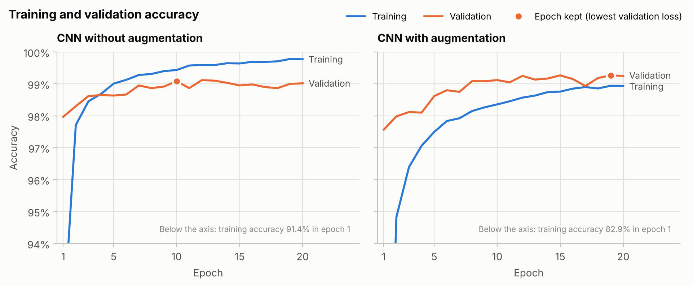
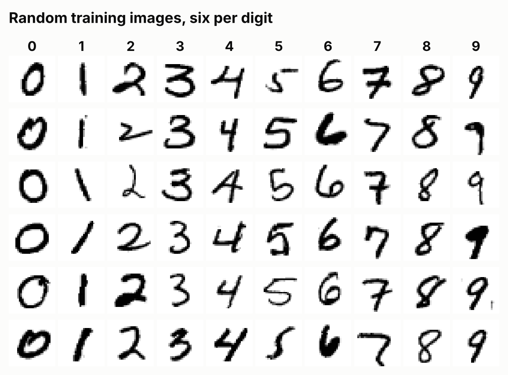
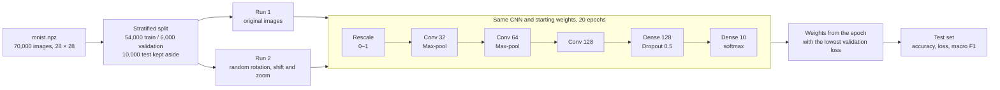
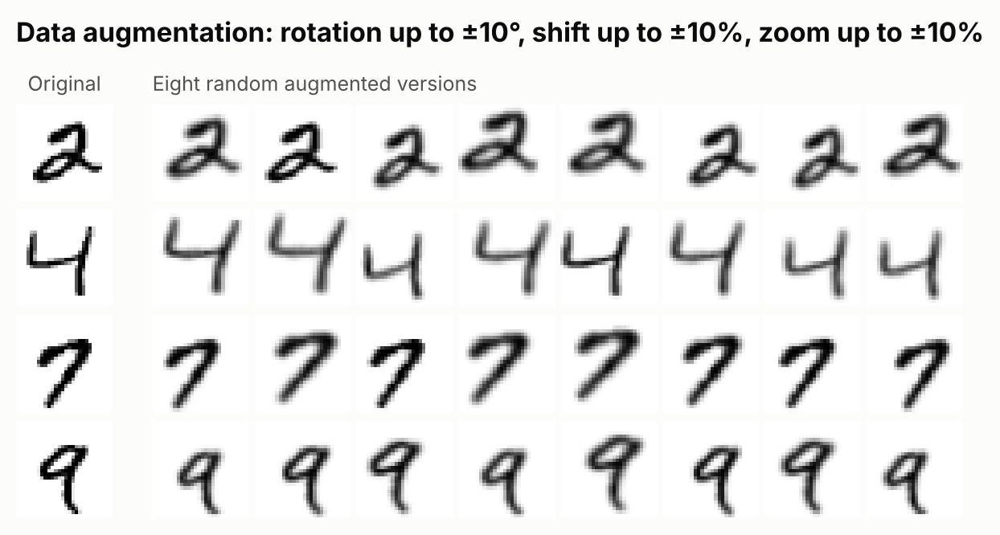
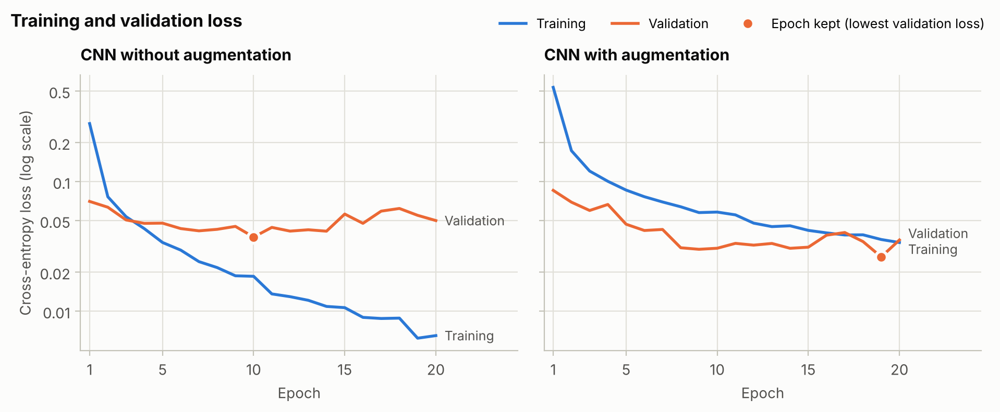
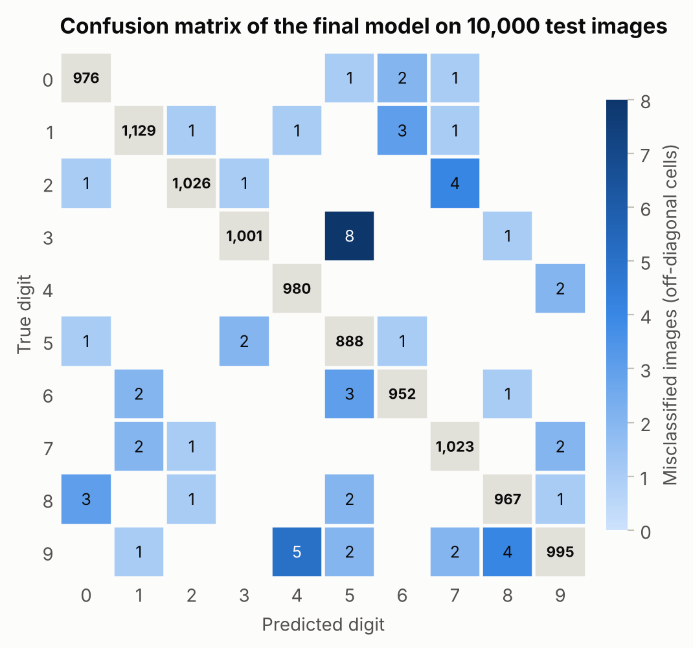
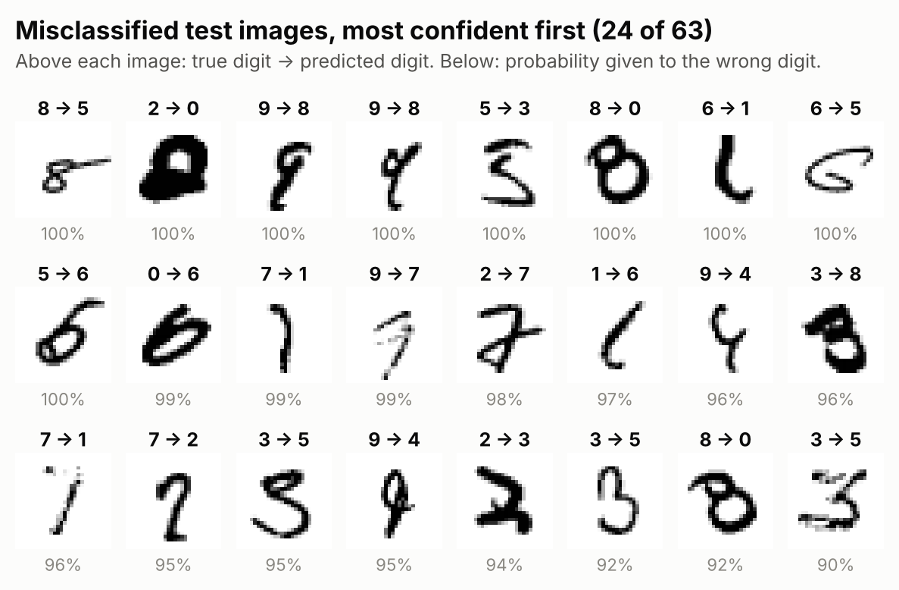

# Progree ML Task 3: Multi-Class Image Classification with a CNN

A convolutional neural network built with TensorFlow/Keras that classifies the handwritten digits of MNIST into ten classes. The network has custom convolutional, max-pooling and fully connected layers. It is trained twice from the same starting weights, once on the original images and once with data augmentation, to measure how much augmentation reduces overfitting. Training and validation accuracy are plotted for both runs.

**Intern:** Omar Hatem Mohamed Emam

**Program:** Progree Remote Machine Learning Internship, 5 November – 5 December 2026

## Results

| Model | Epoch kept | Train accuracy | Validation accuracy | Train–validation gap | Lowest validation loss | Test accuracy | Test errors (of 10,000) |
|---|---|---|---|---|---|---|---|
| CNN without augmentation | 10 | 99.81% | 99.08% | 0.73 points | 0.0374 | 99.31% | 69 |
| **CNN with augmentation (final model)** | **19** | **99.47%** | **99.27%** | **0.20 points** | **0.0263** | **99.37%** | **63** |

Train and validation accuracy are measured with the kept weights, with dropout and augmentation switched off.

Both models classify more than 99.3% of the test images correctly, so on MNIST the gain from augmentation shows mostly in overfitting rather than in accuracy. Without augmentation, validation loss reaches its lowest value at epoch 10 and climbs afterwards, and the kept model is 0.73 percentage points more accurate on its own training images than on the validation images. With augmentation the gap falls to 0.20 points, the lowest validation loss is 30% lower (0.0263 against 0.0374), and on the test set the loss drops from 0.0261 to 0.0212 and the number of errors from 69 to 63.



## Task requirements

| Requirement | Where it is done |
|---|---|
| Multi-layered CNN in TensorFlow/Keras or PyTorch | Keras 3 functional model on TensorFlow 2.21, `build_cnn()` in `src/train.py` |
| Standard vision dataset (MNIST or CIFAR-10) | MNIST, 70,000 handwritten digits in 10 classes |
| Custom convolutional layers | Three `Conv2D` layers with 32, 64 and 128 filters (3 × 3, ReLU) |
| Max-pooling layers | Two `MaxPooling2D` layers (2 × 2) |
| Fully connected layers | `Dense(128, ReLU)` with `Dropout(0.5)`, then `Dense(10, softmax)` |
| Data augmentation to reduce overfitting | `RandomRotation`, `RandomTranslation` and `RandomZoom` in `build_augmentation()`, compared with a run without augmentation |
| Training/validation accuracy curves | `figures/03_accuracy_curves.png`, drawn from `results/history_*.csv` |

## Dataset

MNIST: 70,000 grayscale images of handwritten digits, 28 × 28 pixels, published as 60,000 training and 10,000 test images. The ten classes are close to balanced, with 5,421 to 6,742 training images per digit. A copy is stored in `data/mnist.npz` with the same arrays as the Keras version (`x_train`, `y_train`, `x_test`, `y_test`), and the code downloads it again with `keras.datasets.mnist.load_data()` if the file is missing.

The data are split into three sets:

- 54,000 training images
- 6,000 validation images (a stratified 10% of the training images, seed 42), used to follow overfitting and to choose the epoch whose weights are kept
- 10,000 test images (the official test set), used once for the final evaluation



## Pipeline



The augmentation layers sit in front of the network. They change training batches only and are skipped at prediction time, so validation and test images are never altered. Both runs start from the same random weights and see the batches in the same order, which leaves augmentation as the only difference between them.

## Model

| Layer | Output shape | Parameters |
|---|---|---|
| Input: raw image, pixel values 0–255 | 28 × 28 × 1 | 0 |
| Rescaling to 0–1 | 28 × 28 × 1 | 0 |
| Conv2D, 32 filters 3 × 3, ReLU | 26 × 26 × 32 | 320 |
| MaxPooling 2 × 2 | 13 × 13 × 32 | 0 |
| Conv2D, 64 filters 3 × 3, ReLU | 11 × 11 × 64 | 18,496 |
| MaxPooling 2 × 2 | 5 × 5 × 64 | 0 |
| Conv2D, 128 filters 3 × 3, ReLU | 3 × 3 × 128 | 73,856 |
| Flatten | 1,152 | 0 |
| Dense, 128 units, ReLU | 128 | 147,584 |
| Dropout, rate 0.5 | 128 | 0 |
| Dense, 10 units, softmax | 10 | 1,290 |
| **Total** | | **241,546** |

Training settings: Adam optimizer (learning rate 0.001), sparse categorical cross-entropy loss, batches of 128 images and 20 epochs. A checkpoint keeps the weights from the epoch with the lowest validation loss. Because the rescaling layer is part of the model, the saved files accept raw pixel values.

## Data augmentation



Each training image is rotated by up to ±10°, shifted by up to ±10% of its width and height (about 3 pixels) and zoomed in or out by up to 10%, with new random values in every epoch. Pixels that move in from outside the frame are filled with black. Flips are not used, because a mirrored 2, 3 or 7 is not a valid digit.

## Training curves



Without augmentation, training loss keeps falling (0.0065 at epoch 20) while validation loss reaches its lowest value at epoch 10 (0.0374) and then drifts up to 0.0502, the usual sign of overfitting. With augmentation the two curves stay close. Training loss sits above validation loss for most of the run, because the training batches are augmented and dropout is active during training only. Validation loss moves up and down from one epoch to the next, which is why the best epoch is kept instead of the last one.

## Errors of the final model



The final model misclassifies 63 of the 10,000 test images. The most frequent confusion is a 3 read as a 5 (8 images), followed by a 9 read as a 4 (5 images). Recall is lowest for the digit 9 (98.61%) and precision lowest for the digit 5 (98.23%). Per-digit values are in `results/classification_report.csv`.



Many of the misclassified digits are written in unusual ways, with very thick strokes, open loops or strong slants.

## Limitations

- MNIST is clean, centred and close to solved, so both models score above 99.3% and the effect of augmentation shows more in the loss and in the train–validation gap than in accuracy.
- Each model was trained once with one seed, so the difference of 6 test errors between the two models should not be read as a firm ranking.
- The learning rate is fixed, which makes validation loss jumpy, and the augmented model reached its lowest validation loss at epoch 19 of 20. A learning-rate schedule, longer training or the same pipeline on CIFAR-10 would be the next things to try.

## Repository structure

```
Progree-ML-Task3-CNN-Image-Classification/
├── Task3_CNN_Image_Classification.ipynb   # full walkthrough with outputs and figures
├── src/
│   └── train.py                           # command-line training script with logging
├── data/
│   └── mnist.npz                          # MNIST, 60,000 training and 10,000 test images
├── figures/                               # PNG figures produced by the notebook
├── models/
│   ├── cnn_baseline.keras                 # CNN trained without augmentation
│   └── cnn_augmented.keras                # CNN trained with augmentation (final model)
├── results/
│   ├── train.log                          # log written by src/train.py
│   ├── history_baseline.csv               # loss and accuracy per epoch, without augmentation
│   ├── history_augmented.csv              # loss and accuracy per epoch, with augmentation
│   ├── metrics.json                       # accuracy, loss and macro F1 on each split
│   ├── model_comparison.csv               # the two models side by side
│   └── classification_report.csv          # precision, recall and F1 per digit, final model
├── requirements.txt
└── README.md
```

## How to run

Clone or download the repository, then run from its root folder:

```bash
pip install -r requirements.txt

# train both models, log the metrics and save the models
python src/train.py

# or work through the notebook
jupyter notebook Task3_CNN_Image_Classification.ipynb
```

The script takes about 11 minutes on a 2-core CPU; `python src/train.py --help` lists its options (epochs, batch size, seed and output folders). Results are reproducible with the fixed random seed (42) and TensorFlow's deterministic mode, and the notebook and the script give the same numbers. Tested with Python 3.13, TensorFlow 2.21.0, Keras 3.15.1, NumPy 2.5.3, scikit-learn 1.9.1, pandas 3.0.5 and Matplotlib 3.11.2.

## Using the saved model

```python
import keras
import numpy as np

model = keras.models.load_model("models/cnn_augmented.keras")
with np.load("data/mnist.npz") as data:
    images, labels = data["x_test"][:5], data["y_test"][:5]

probs = model.predict(images[..., None].astype("float32"), verbose=0)  # raw 0-255 pixels
print(probs.argmax(axis=1), labels)
```

The model files were saved with Keras 3.15.1 on TensorFlow 2.21.0; load them with Keras 3.

## Acknowledgements

- Progree, for the internship tasks.
- Data: LeCun, Y., Bottou, L., Bengio, Y. and Haffner, P. (1998). Gradient-based learning applied to document recognition. *Proceedings of the IEEE*, 86(11), 2278–2324. The copy in `data/mnist.npz` comes from the [ylecun/mnist](https://huggingface.co/datasets/ylecun/mnist) dataset on Hugging Face, saved in the array layout used by `keras.datasets.mnist`.
